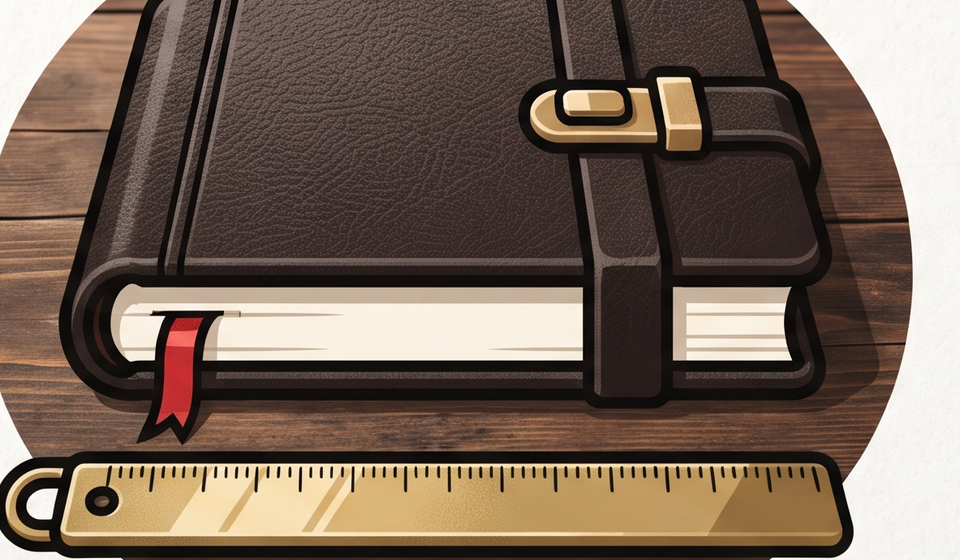

# codeintel-Inconsistent-Naming-Convention-Detector

Identifies inconsistencies in naming conventions (e.g., variable names, function names) across the codebase. Uses regular expressions or simple parsing to detect violations of established naming patterns. - Focused on Tools for static code analysis, vulnerability scanning, and code quality assurance

## Install
`git clone https://github.com/ShadowStrikeHQ/codeintel-inconsistent-naming-convention-detector`

> **Lot note, wrong seller named.** The clone line above names ShadowStrikeHQ rather than ShadowGuard-AI. It is kept as printed and flagged here, not quietly mended. The repository LICENSE file carries the MIT License, while the closing line of this README reads Copyright (c) ShadowStrikeHQ; both facts stand as printed.

## Usage
`./codeintel-inconsistent-naming-convention-detector [params]`

> **Lot note, placeholder usage.** The usage line above is a placeholder that the argument parser does not accept. The invocation the parser in main.py does accept is `python3 main.py FILENAME [--variable-pattern REGEX] [--function-pattern REGEX]`, where filename, the path to the Python file to analyse, is a required positional argument that appears in no parameter entry below.

## Parameters
- `-h`: Show help message and exit
- `--variable-pattern`: Regex for variable naming convention. Default is snake_case.
- `--function-pattern`: Regex for function naming convention. Default is snake_case.

> **Lot note, the exit code is not a verdict.** The program prints a headed list of inconsistencies, or the sentence reporting that none were found, and exits 0 in both cases. The printed list is the whole result.

## License
Copyright (c) ShadowStrikeHQ

> **Lot note, wrong seller named.** The copyright line above names ShadowStrikeHQ rather than ShadowGuard-AI. It is kept as printed and flagged here. The repository LICENSE file carries the MIT License.
